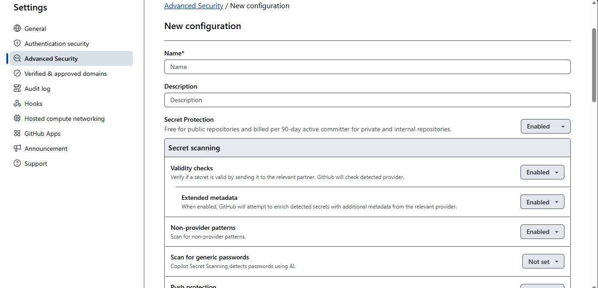
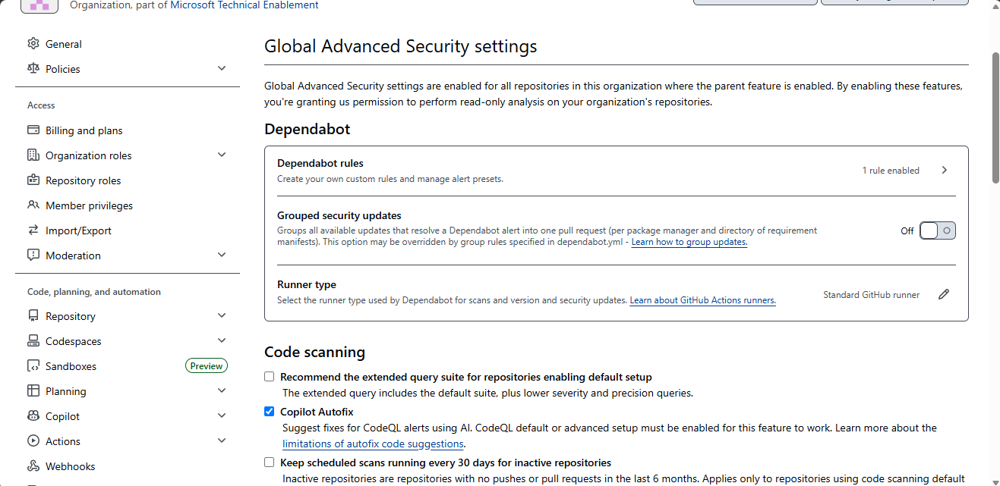
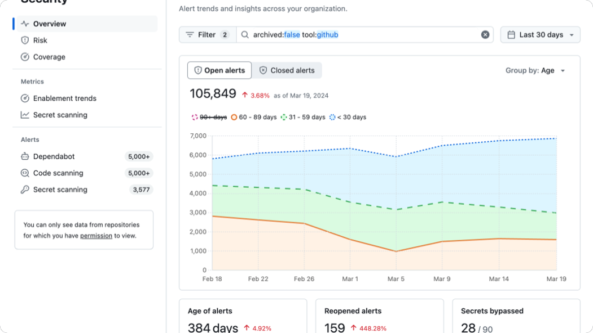

<!--
title: "Module 30: Application Security - Overview & Management"
template: default
-->

# Application Security: Overview & Management

---

## Security Overview

<!--
layout: section
-->

---

## Application Security

<!--
layout: content
-->

- Common vulnerabilities in application code:
  - **Leaked credentials and secrets:** hard-coded API keys, tokens, and private keys can be exposed in code, logs, or configuration and lead to account takeover.
  - **Application code vulnerabilities:** input-handling flaws such as SQL Injection, Cross-Site Scripting (XSS), and command injection allow attackers to manipulate application behavior and access data.
  - **Supply chain vulnerabilities:** vulnerable or malicious third-party libraries, packages, and build dependencies can introduce risk without changing your own application code.

- Why this matters:
  - IBM Cost of a Data Breach Report 2024: the global average cost of a data breach was $4.88M.
  - Verizon DBIR: 31% of breaches now start with software vulnerabilities.
  - Synopsys OSSRA 2024: 84% of audited codebases contained at least one open-source vulnerability.

```speaker-notes
References:
- IBM Cost of a Data Breach Report 2024: https://www.ibm.com/reports/data-breach
- Verizon Data Breach Investigations Report: https://www.verizon.com/business/resources/reports/dbir/
- Synopsys OSSRA 2024: https://www.synopsys.com/software-integrity/resources/analyst-reports/ossra.html
```

---

## GitHub Security Product Overview

<!--
layout: content
-->

- **GitHub Dependabot:** Software supply chain (dependency) vulnerability identification and remediation

- **GitHub Secret Protection:** Detects, blocks, and accelerates remediation of leaked secrets

- **GitHub Code Security:** Identifies and code vulnerabilities and assists in automatic remediation

- **GitHub Advanced Security:** Bundles GitHub Secret Protection and GitHub Code Security

```speaker-notes
- Dependabot features Dependency alerts, automated security updates, dependency review in pull requests; included with GitHub
- Secret Protection features Secret scanning alerts, push protection, delegated bypass, and partner pattern coverage; licensed per-active committer, per month - or bundled with GHAS
- GitHub Code Security features Code scanning with CodeQL and third-party engines, security campaigns, integrated vulnerability context, Autofix, and Security Overview reporting; licensed per-active committer, per month - or bundled with GHAS
- GHAS bundles Secret Protection and Code Security; licensed per-active committer, per month

References:
- https://github.com/security/advanced-security
- https://docs.github.com/en/code-security
- https://docs.github.com/en/code-security/getting-started/github-security-features
- https://docs.github.com/en/code-security/tutorials/improve-code-quality/quickstart
```

---

## Securing your code

<!--
layout: content
-->

- **Security Debt**
  - Form the baseline: inventory current secret and code vulnerabilities to establish starting risk
  - Systematically remediate the highest priority risks
  - Tighten policies as appropriate to mitigate future vulnerabilities

- **Minimize future security risk**
  - Set policies to minimize ongoing security risk across the organization

```speaker-notes
- Start with visibility: know your baseline for leaked secrets and code vulnerabilities.
- Audits are available for secret and code scanning to expose risk – does not require a license but does not expose details or mitigation tools.
- Once baseline is established, run remediation and policy enforcement in parallel.
- Tighten policy rollout over time by repository coverage and severity thresholds until desired security outcomes are stable.
```

---

## Establishing a security baseline

<!--
layout: content
-->

- **Phase 1 — Pilot (Select Repositories)**
  - Inventory current risk: run security tool audits to establish a vulnerability baseline
  - Enable security tools (dependency, secret, and code scanning) on pilot repositories
  - Define triage workflows, alert ownership, and remediation SLAs
  - Validate signal quality: measure false-positive rate and operational burden before expanding

- **Phase 2 — Organization-Wide Rollout**
  - Set org-level security defaults so all new and existing repositories inherit the baseline
  - Enforce prevention policies: block secrets at push and require security checks before merge
  - Codify branch protections and merge controls with rulesets; apply RBAC with least privilege
  - Document an exception process with expiry dates and accountable approvers

- **Phase 3 — Governance & Continuous Improvement**
  - Assign policy owners, publish RACI, and set a fixed reporting cadence
  - Track trend metrics (open findings, time-to-remediate, recurrence) and recalibrate thresholds

```speaker-notes
References:
- Concepts for security at scale - GitHub Docs
- Best practices for selecting pilot repositories - GitHub Docs
- Enabling security features at scale - GitHub Docs
```

---

## Code Security Configurations

<!--
layout: content
-->

- **Code Security Configurations**
  - Named collections of Dependabot, secret scanning, and code scanning settings applied to repository groups
  - Enforced configs lock settings at all levels; non-enforced configs provide a baseline repos can override

- **Configuration Types**
  - GitHub-recommended: pre-built config with suggested settings for all security products, maintained by GitHub
  - Custom: tailor settings per risk profile (e.g., "High risk" for production, "Minimum protection" for internal)
  - Default: auto-applied to new repos created in the org, preventing coverage gaps

- **Configuration Statuses**
  - Attached/Enforced: config actively applied; enforced means repo admins cannot change controlled features
  - Removed/Detached: repo-level override conflicts with config, or config is no longer linked to the repo
  - License impact is shown before applying a config, so you can track GHAS consumption

```speaker-notes
References:
- https://docs.github.com/en/code-security
- https://docs.github.com/enterprise-cloud@latest/admin/managing-code-security/securing-your-enterprise/about-security-configurations
- https://docs.github.com/en/code-security/how-tos/secure-at-scale/configure-organization-security/establish-complete-coverage/configure-global-settings
```

---

## Code Security Configuration Scope

<!--
layout: table
-->

| Scope | Enterprise | Organization | Repository |
| --- | --- | --- | --- |
| Dependabot | Alerts + security updates in enterprise configs<br>Centralized private registry credentials | Enable alerts for all new + existing repos<br>Automated security + version updates org-wide<br>Internal repo access for cross-repo resolution | dependabot.yml for schedules, branches, registries<br>Dependency review to block vulnerable packages<br>Triage: ownership, SLAs, remediation tracking |
| Secret Scanning | Enforce scanning + push protection across all orgs<br>Custom patterns for proprietary credentials | Enable for all repos; push protection on<br>Delegated bypass governance<br>Validity checks + auto-triage rules | Inherited; tunable per repo<br>Triage: ownership, SLAs, closure evidence<br>Rotate/revoke secrets, verify remediation |
| Code Scanning | CodeQL default/advanced setup in configs<br>Enforce requirements across all orgs | Default CodeQL or custom workflows per language<br>Standardize query suites + severity thresholds<br>Autofix for AI remediation suggestions | Require on PRs + protected branches<br>Third-party SARIF alongside CodeQL<br>Dismissal governance with audit trail |

```speaker-notes
References:
- https://docs.github.com/en/code-security
- https://docs.github.com/enterprise-cloud@latest/admin/managing-code-security/securing-your-enterprise/about-security-configurations
- https://docs.github.com/en/code-security/how-tos/secure-at-scale/configure-organization-security/establish-complete-coverage/configure-global-settings
```

---

## Enterprise & Organization Security

<!--
layout: section
-->

---

## Enterprise Security Settings

<!--
layout: content
hidden: true
-->

- **Security Configurations**
  - Named configurations applied across all organizations
  - GitHub-recommended or custom; enforced or non-enforced
  - Apply to all repos, unmanaged repos, or new repos only

- **Secret Protection**
  - Secret scanning with validity checks and extended metadata
  - Non-provider patterns and push protection
  - Delegated bypass and custom patterns

- **Code Security**
  - CodeQL scanning (default or advanced setup)
  - Dependabot alerts and security updates
  - Autofix for AI-powered remediation

- **Enforcement**
  - Enforced configs prevent org-level overrides
  - Enterprise configs visible at org level for rollout



```speaker-notes
**NOTE:** This and the following slide are hidden with the expectation that you'll do the demo walking through the settings.  If you have a developer audience who isn't highly interested in this content, you can unhide these slides and use them in lieu of a demo.
```

---

## Organization Security Settings

<!--
layout: content
hidden: true
-->

- **Security Configurations**
  - Custom or GitHub-recommended configs for repo groups
  - Enforced locks settings; non-enforced provides baseline
  - Default config auto-applied to new repositories

- **Global Dependabot Settings**
  - Auto-triage rules to dismiss, snooze, or fix alerts
  - Grouped security updates into single PRs
  - Dependabot on Actions runners

- **Global Code Scanning Settings**
  - Extended query suites for deeper analysis
  - Autofix suggestions on pull requests
  - Third-party SARIF integration

- **Global Secret Scanning Settings**
  - Custom patterns for proprietary credentials
  - Push protection bypass governance
  - Validity checks and pattern-level config

- **Security Managers**
  - Assign security manager role for org-wide access



```speaker-notes
**NOTE:** This and the prior slide are hidden with the expectation that you'll do the demo walking through the settings.  If you have a developer audience who isn't highly interested in this content, you can unhide these slides and use them in lieu of the demo.
```

---

## DEMO

<!--
layout: demo
-->

- Enterprise-level settings

- Organization-level settings

```speaker-notes
Provide this as a top-level introduction for developer audiences or a more detailed version for admin audiences. If appropriate, you can swap this demo for an Instructor-Guided exercise and walk the customer through their own configuration.

Reference: https://learn.microsoft.com/en-us/training/modules/github-administration-github-advanced-security/

- Navigate to an Enterprise where you have permissions > Settings > Advanced Security
- "New Configuration" and walk through settings > Cancel
- Click on "GitHub Recommended" to show defaults > Cancel
- Show "Apply to" drop down at high level – defer to org setup
- Show Secrets protection and patterns
- Navigate to an Org where you have permissions > Settings >
```

---

## Repository Security

<!--
layout: section
-->

---

## Configuring Dependabot (Repository)

<!--
layout: content
-->

- **dependabot.yml Configuration**
  - Define custom update schedules (daily, weekly, monthly) per package ecosystem
  - Specify target branches, directories, and private registry credentials
  - Set open-pull-requests-limit, assignees, reviewers, and labels per ecosystem
  - Use ignore rules and group updates to reduce PR noise

- **Dependency Review**
  - Enforce dependency-review-action in CI to block PRs introducing known vulnerabilities
  - Configure severity thresholds and license allow/deny lists in the action's config

- **Alert Triage & Remediation**
  - Assign alert ownership, define SLAs by severity (Critical/High within 1 week)
  - Use auto-triage rules to dismiss or snooze low-risk alerts automatically
  - Track remediation progress through Security Overview dashboards

---

## Secret Scanning (Repository)

<!--
layout: content
-->

- **Enabling & Configuring Secret Scanning**
  - Inherited org settings apply automatically; non-enforced settings can be tuned per repo
  - Enable push protection to block secrets before they enter the repository
  - Define custom patterns to detect proprietary credential formats specific to your org

- **Alert Triage & Response**
  - Assign alert ownership with defined SLAs and closure evidence requirements
  - Rotate or revoke detected secrets immediately; verify remediation before closing alerts
  - Use validity checks to confirm whether leaked tokens are still active

- **Push Protection Bypass Governance**
  - Delegated bypass: define who can bypass, when, and with what justification
  - All bypass events are logged in the audit trail for compliance review

---

## Code Scanning (Repository)

<!--
layout: content
-->

- **Requiring Code Scanning**
  - Require code scanning on pull requests and protected branches via rulesets
  - Configure merge protection rules: block merges when alerts exceed severity thresholds
  - Use default CodeQL setup for automatic language detection and zero-config scanning

- **Third-Party Tool Integration**
  - Upload SARIF results from third-party scanners (e.g., Semgrep, Checkmarx) alongside CodeQL
  - All results appear unified in the Security tab for consistent triage

- **Alert Dismissal Governance**
  - Enable delegated dismissal: control who can dismiss alerts and require justification
  - Leverage Autofix for AI-powered remediation suggestions on pull requests
  - Dismissals and closures are tracked in the audit log for accountability

---

## DEMO

<!--
layout: demo
-->

- **Dependabot Configuration**

- **Secret Scanning & Push Protection**

- **Code Scanning with CodeQL**

```speaker-notes
- **Dependabot Configuration**
  - Add a dependabot.yml to .github/; set package-ecosystem, schedule, and target-branch per ecosystem
  - Enable the dependency-review-action in CI to block PRs that introduce known vulnerabilities
  - Walk through Dependabot alerts: assign ownership, apply auto-triage rules, and show grouped version updates
- **Secret Scanning & Push Protection**
  - Enable secret scanning and push protection under Settings → Code security; show inherited org defaults
  - Demo a blocked push: commit a test secret, show the push-protection prompt, then bypass with justification
  - Define a custom pattern (regex) for an internal credential format; trigger a scan and triage the alert
- **Code Scanning with CodeQL**
  - Enable default CodeQL setup (auto-detects languages); show how to switch to advanced setup for custom queries
  - Create a repository ruleset requiring code-scanning results to pass before merge
  - Enable delegated alert dismissal; demo the review-and-approve workflow for closing findings


References:
- Quickstart for securing your repository — https://docs.github.com/en/code-security/getting-started/quickstart-for-securing-your-repository
- Dependabot quickstart guide — https://docs.github.com/en/code-security/getting-started/dependabot-quickstart-guide
- Dependabot options reference (dependabot.yml) — https://docs.github.com/en/code-security/dependabot/working-with-dependabot/dependabot-options-reference
- Configuring the dependency review action — https://docs.github.com/en/code-security/supply-chain-security/understanding-your-software-supply-chain/configuring-the-dependency-review-action
- Enabling secret scanning for your repository — https://docs.github.com/en/code-security/secret-scanning/enabling-secret-scanning-features/enabling-secret-scanning-for-your-repository
- Push protection — https://docs.github.com/en/code-security/secret-scanning/introduction/about-push-protection
- Defining custom patterns for secret scanning — https://docs.github.com/en/code-security/secret-scanning/using-advanced-secret-scanning-and-push-protection-features/custom-patterns/defining-custom-patterns-for-secret-scanning
- Enabling delegated bypass for push protection — https://docs.github.com/en/code-security/secret-scanning/using-advanced-secret-scanning-and-push-protection-features/delegated-bypass-for-push-protection/enabling-delegated-bypass-for-push-protection
- Configuring advanced setup for code scanning — https://docs.github.com/en/code-security/code-scanning/enabling-code-scanning/configuring-advanced-setup-for-code-scanning
- Code scanning merge protection (rulesets) — https://docs.github.com/en/code-security/code-scanning/managing-code-scanning-alerts/about-code-scanning-alerts-in-rulesets
- Uploading a SARIF file to GitHub — https://docs.github.com/en/code-security/code-scanning/integrating-with-code-scanning/uploading-a-sarif-file-to-github
- Enabling delegated alert dismissal for code scanning — https://docs.github.com/en/code-security/code-scanning/managing-code-scanning-alerts/enabling-delegated-alert-dismissal-for-code-scanning

Microsoft Learn Training:
- GitHub Advanced Security Part 1 of 2 — https://learn.microsoft.com/en-us/training/paths/github-advanced-security-1/
- GitHub Advanced Security Part 2 of 2 — https://learn.microsoft.com/en-us/training/paths/github-advanced-security-2/
- Configure Dependabot security updates on your GitHub repo — https://learn.microsoft.com/en-us/training/modules/configure-dependabot-security-updates-on-github-repo/
- Configure and use secret scanning in your GitHub repository — https://learn.microsoft.com/en-us/training/modules/configure-use-secret-scanning-github-repository/
```

---

## Advanced Topics

<!--
layout: content
-->

- **Custom CodeQL**
  - Advanced setup: define custom CodeQL workflows per language and framework
  - Author custom query packs targeting org-specific vulnerability patterns
  - Choose extended query suites for deeper analysis beyond the default set

- **Third-Party SARIF Integration**
  - Upload SARIF results from third-party scanners (e.g., Semgrep, Checkmarx) alongside CodeQL
  - All results appear unified in the Security tab for consistent triage

- **Security Campaigns**
  - Organize targeted remediation sprints around specific vulnerability classes
  - Track campaign progress across repos with Security Overview dashboards

- **Dependabot Advanced Configuration**
  - Multi-directory and multi-ecosystem configurations in a single dependabot.yml
  - Grouped version updates: batch related dependency PRs to reduce review burden
  - Self-hosted runners for Dependabot when scanning private network registries

---

## Security Reporting & Campaigns

<!--
layout: section
-->

---

## Security Overview Dashboard

<!--
layout: content
-->

- **Security Overview is…**
  - Consolidated dashboard for detection, remediation, and prevention metrics across all security alerts
  - Available at enterprise, organization, and repository levels

- **Dashboard Tabs**
  - Detection: alert status, age, secrets blocked, high-risk repos
  - Remediation: mean time to remediate, closure trends, reopened rate
  - Prevention: push protection effectiveness, merge blocks, net alert trend



```speaker-notes
References:
- Security overview — https://docs.github.com/en/code-security/security-overview/about-security-overview
- Security overview dashboard metrics — https://docs.github.com/en/code-security/security-overview/viewing-metrics-for-your-organization
- Viewing security insights — https://docs.github.com/en/code-security/security-overview/viewing-security-insights
```

---

## Reporting Views by Scope

<!--
layout: content
-->

- **Enterprise Level**
  - Aggregated risk and coverage views spanning all organizations in the enterprise
  - Identify orgs with the highest concentration of critical/high alerts
  - Track enablement trends: percentage of repos with scanning enabled over time

- **Organization Level**
  - Overview dashboard with detection, remediation, and prevention tabs
  - Risk view: repositories ranked by open alert count and severity
  - Coverage view: which repos have each security feature enabled and where gaps remain
  - Enablement trends report: adoption rate of Dependabot, secret scanning, and code scanning

- **Repository Level**
  - Security tab shows all alerts from Dependabot, secret scanning, and code scanning in one view
  - Filter by severity, tool, state, and branch; drill into individual alert details and remediation steps
  - Pull request integration: alerts surface directly in PR checks and code review

```speaker-notes
References:
- Assessing adoption of security features — https://docs.github.com/en/code-security/security-overview/assessing-adoption-of-code-security
- Enterprise risk and coverage views — https://docs.github.com/en/enterprise-cloud@latest/code-security/security-overview/about-security-overview
```

---

## Security Campaigns

<!--
layout: content
-->

- **Security Campaigns are…**
  - Organization-wide, time-boxed remediation drives targeting a specific class of alerts
  - Available for code scanning and secret scanning alerts (secret scanning campaigns in public preview)
  - Managed from the Security tab → Campaigns in the organization view

- **Creating a Campaign**
  - Use built-in campaign templates (e.g., Cross-site scripting, SQL injection) or define custom filters
  - Set a campaign name, due date, and contact team; select up to 1,000 alerts per campaign
  - Copilot Autofix generates fix suggestions for included alerts, accelerating developer remediation

- **Tracking Progress**
  - Campaign tracking view shows open vs. closed alerts, percent complete, and at-risk campaigns
  - Drill into individual campaigns to see per-repository progress and stalled work
  - Developers see campaign context on their alerts, linking individual fixes to the broader goal

```speaker-notes
References:
- Creating and managing security campaigns — https://docs.github.com/en/code-security/security-campaigns/creating-and-managing-security-campaigns
- Tracking security campaigns — https://docs.github.com/en/code-security/security-campaigns/tracking-security-campaigns
- Running a security campaign to fix alerts at scale — https://docs.github.com/en/code-security/tutorials/running-a-security-campaign
```

---

## DEMO

<!--
layout: demo
-->

- **Security Overview Dashboards**

- **Enablement & Adoption Reporting**

- **Security Campaigns**

```speaker-notes
- **Security Overview Dashboards**
  - Navigate to the enterprise Security tab; review aggregated risk and coverage across orgs
  - Switch to an organization; walk through Detection, Remediation, and Prevention dashboard tabs
  - Show risk and coverage views; filter by severity, tool, and team; export data as CSV
- **Enablement & Adoption Reporting**
  - Open the enablement trends report; show adoption rate of each security feature over time
  - Identify repos without coverage using the coverage view; apply a security configuration to close gaps
- **Security Campaigns**
  - Create a campaign from a template (e.g., Cross-site scripting); set due date and contact team
  - Show how Copilot Autofix generates suggested fixes for campaign alerts
  - Open the campaign tracking view; review progress, stalled work, and per-repo breakdown


References:
- Security overview — https://docs.github.com/en/code-security/security-overview/about-security-overview
- Creating and managing security campaigns — https://docs.github.com/en/code-security/security-campaigns/creating-and-managing-security-campaigns
- Tracking security campaigns — https://docs.github.com/en/code-security/security-campaigns/tracking-security-campaigns

Microsoft Learn:
- GitHub Administration for GitHub Advanced Security — https://learn.microsoft.com/en-us/training/modules/github-administration-for-github-advanced-security/
```

---

## Wrap-up

<!--
layout: section
-->

---

## Module Summary

<!--
layout: content
-->

- **Security Foundations**
  - Common application vulnerabilities: leaked secrets, code flaws, and supply chain risk
  - GitHub security products: Dependabot, Secret Protection, Code Security, and GHAS bundles

- **Configuration at Scale**
  - Code Security Configurations: named setting bundles applied at enterprise and org levels
  - Phased rollout: pilot → org-wide defaults → governance and continuous improvement

- **Repository-Level Security**
  - Dependabot: dependabot.yml, dependency review, alert triage and remediation
  - Secret scanning: push protection, custom patterns, delegated bypass governance
  - Code scanning: CodeQL setup, merge protection rulesets, SARIF integration, alert dismissal controls

- **Reporting & Campaigns**
  - Security Overview dashboards at enterprise, org, and repo levels
  - Security campaigns: time-boxed, org-wide remediation drives with Copilot Autofix

---

## Lab Exercises

<!--
layout: content
-->

- **Exercise 1: Configure Dependabot Security Updates**

- **Exercise 2: Configure and Use Secret Scanning**

- **Exercise 3: Code Scanning with CodeQL**

- **Exercise 4: Security Overview & Campaigns**

```speaker-notes
- **OPTIONAL:** If presenting to an admin audience, consider replacing all of these with instructor-guided exercises to help the customer walk through their environment and update settings at all levels as appropriate.
- **Exercise 1: Configure Dependabot Security Updates**
  - Enable Dependabot alerts, configure security updates, review and merge Dependabot PRs
  - Reference: https://learn.microsoft.com/en-us/training/modules/configure-dependabot-security-updates-on-github-repo/
- **Exercise 2: Configure and Use Secret Scanning**
  - Enable secret scanning, review alerts, test push protection, define a custom pattern
  - Reference: https://learn.microsoft.com/en-us/training/modules/configure-use-secret-scanning-github-repository/
- **Exercise 3: Code Scanning with CodeQL**
  - Enable default CodeQL setup, reference a custom query, review and triage code scanning alerts
  - Reference: https://learn.microsoft.com/en-us/training/modules/code-scanning-with-github-codeql/
- **Exercise 4: Security Overview & Campaigns**
  - **NOTE:** This exercise targets a security admin role with appropriate permissions; you may need to omit it for a general developer audience.
  - Navigate Security Overview dashboards, assess feature adoption, create and track a campaign
  - Microsoft Learn: https://learn.microsoft.com/en-us/training/modules/github-administration-for-github-advanced-security/
```
