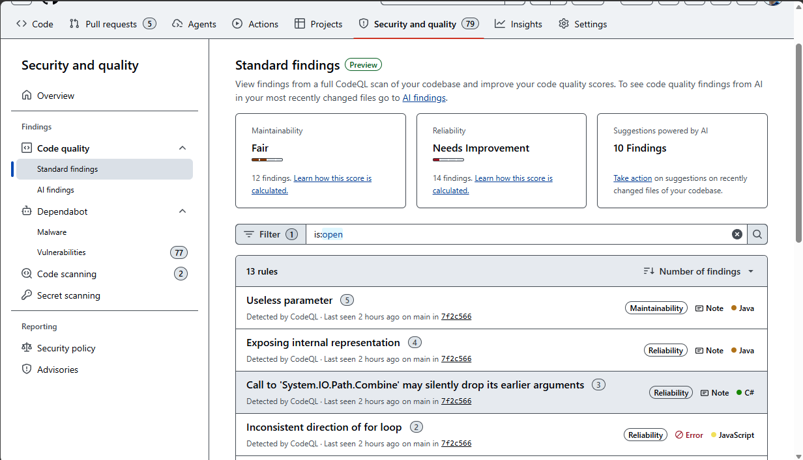

<!--
title: "Module 32: Code Quality"
template: default
-->

# Code Quality: Monitoring & Improvement

---

## Code Quality Overview

<!--
layout: section
-->

---

## GitHub Code Quality

<!--
layout: content
-->

- **GitHub Code Quality helps teams improve reliability and maintainability**
  - Flags rule-based issues on the default branch and in pull requests using CodeQL-powered analysis
  - Surfaces AI findings separately for recently pushed code on the default branch
  - Posts `github-code-quality[bot]` feedback on pull requests, including coverage summaries when configured

- **Built for both developers and administrators**
  - Developers get actionable findings, explanations, and Copilot-powered autofix suggestions
  - GitHub administrators and engineering leads get repository and organization views to monitor adoption and code health

```speaker-notes
References:
- About GitHub Code Quality — https://docs.github.com/en/code-security/concepts/about-code-quality
- Enabling GitHub Code Quality — https://docs.github.com/en/code-security/how-tos/maintain-quality-code/enable-code-quality
```

---

## Why this matters

<!--
layout: content
-->

- **Code quality is an operational signal**
  - Reliability issues increase defects, regressions, and rework
  - Maintainability issues slow feature delivery and compound technical debt

- **GitHub Code Quality turns quality into a repeatable workflow**
  - Detect issues on the default branch and on pull requests
  - Prioritize by severity and metric impact
  - Fix or dismiss findings with context, examples, and remediation guidance
  - Enforce standards with PR thresholds and reviewer-visible coverage data

```speaker-notes
References:
- Improving the quality of your repository's code — https://docs.github.com/en/code-security/tutorials/improve-code-quality/improve-your-codebase
- Metrics and ratings reference — https://docs.github.com/en/code-security/reference/code-quality/metrics-and-ratings
```

---

## Establishing a code quality baseline

<!--
layout: content
-->

- **Phase 1 — Pilot repositories**
  - Enable Code Quality on a small set of representative repositories
  - Confirm supported languages, GitHub Actions readiness, and initial scan completion
  - Review top findings by severity and group related issues by rule

- **Phase 2 — Team and organization rollout**
  - Expand repository coverage and teach teams how to interpret findings
  - Add PR thresholds only after Code Quality checks run successfully on pull requests
  - Publish expectations for remediation ownership, triage, and exceptions

- **Phase 3 — Governance and improvement**
  - Use organization dashboards to locate low-scoring repositories
  - Track rating changes, coverage deltas, and repeated finding patterns over time

```speaker-notes
References:
- Enabling GitHub Code Quality — https://docs.github.com/en/code-security/how-tos/maintain-quality-code/enable-code-quality
- Setting code quality thresholds for pull requests — https://docs.github.com/en/code-security/how-tos/maintain-quality-code/set-pr-thresholds
- Improving the quality of your repository's code — https://docs.github.com/en/code-security/tutorials/improve-code-quality/improve-your-codebase
- Configure code scanning on GitHub — https://learn.microsoft.com/en-us/training/modules/configure-code-scanning/
```

---

## Platform prerequisites and supported languages

<!--
layout: content
-->

- **Prerequisites**
  - Enterprise owners must allow Code Quality if the organization belongs to an enterprise
  - GitHub Actions must be enabled because Code Quality runs CodeQL analysis in Actions
  - Repositories should use supported languages for rule-based analysis

- **Supported languages for rule-based analysis**
  - C#, Go, Java, JavaScript, Python, Ruby, and TypeScript

```speaker-notes
References:
- About GitHub Code Quality — https://docs.github.com/en/code-security/concepts/about-code-quality
- Enabling GitHub Code Quality — https://docs.github.com/en/code-security/how-tos/maintain-quality-code/enable-code-quality
```

---

## Improving Quality in the Developer Workflow

<!--
layout: section
-->

---

## Repository findings and Autofix

<!--
layout: content
-->

- **Standard findings**
  - Rule-based results on the default branch are grouped by rule and assigned a severity of **Error**, **Warning**, or **Note**

  - Reliability and maintainability ratings improve only when the highest-severity findings affecting that metric are resolved

- **AI-assisted remediation**
  - Developers can open a finding, review the explanation and examples, and generate a Copilot-powered autofix where available
  - Findings can be fixed or dismissed after validating impact and correctness

- **Pull request feedback**
  - New or updated pull requests against the default branch receive Code Quality checks and inline bot feedback



```speaker-notes
References:
- Improving the quality of your repository's code — https://docs.github.com/en/code-security/tutorials/improve-code-quality/improve-your-codebase
- Metrics and ratings reference — https://docs.github.com/en/code-security/reference/code-quality/metrics-and-ratings
- About GitHub Code Quality — https://docs.github.com/en/code-security/concepts/about-code-quality
```

---

## Pull request quality gates

<!--
layout: content
-->

- **Rulesets enforce quality thresholds**
  - Add the **Require code quality results** branch rule to block pull requests below your chosen threshold
  - Thresholds can require resolution of **Errors**, **Warnings and higher**, **Notes and higher**, or **All** findings

- **Coverage adds reviewer context**
  - Upload Cobertura XML coverage reports with `actions/upload-code-coverage@v1`
  - Pull requests show aggregate coverage compared to the default branch and a per-file coverage breakdown

- **Safe rollout pattern**
  - Confirm the `CodeQL - Code Quality` check already runs successfully on pull requests before turning the rule on

```speaker-notes
References:
- Setting code quality thresholds for pull requests — https://docs.github.com/en/code-security/how-tos/maintain-quality-code/set-pr-thresholds
- Setting up code coverage for your repository — https://docs.github.com/en/code-security/how-tos/maintain-quality-code/set-up-code-coverage
- Process a pull request — https://learn.microsoft.com/en-us/contribute/content/process-pull-request
```

---

## Interpreting metrics and ratings

<!--
layout: table
-->

| Signal | Meaning | Example use |
| --- | --- | --- |
| Reliability | Whether code behaves correctly, predictably, and safely | Prioritize correctness, error handling, performance, concurrency, accessibility, and security-related findings |
| Maintainability | How easy the code is to understand, modify, and extend | Prioritize duplication, complexity, dead code, best-practice gaps, and documentation issues |
| Severity | Error, Warning, or Note | Use severity to decide whether to gate merges, fix immediately, or schedule remediation |
| Rating | Excellent, Good, Fair, Needs Improvement | Use ratings to summarize repository health and track improvement over time |

```speaker-notes
References:
- Metrics and ratings reference — https://docs.github.com/en/code-security/reference/code-quality/metrics-and-ratings
```

---

## Monitoring Code Quality at Organization Scope

<!--
layout: content
-->

- **Organization dashboard**
  - Navigate to **Security and quality** → **Code quality** to review organization-wide results
  - The score distribution chart groups repositories by maintainability and reliability scores

- **Repository table**
  - Sort and drill into repositories from the dashboard to inspect recent scans and standard findings
  - Filter toward low-scoring repositories first, then open the repository-level dashboard for action
  
- **Admin and lead workflow**
  - Identify outliers, assign owners, and turn dashboard observations into issues, backlog items, or coaching opportunities

```speaker-notes
References:
- Exploring GitHub Code Quality results in your organization — https://docs.github.com/en/code-security/how-tos/view-and-interpret-data/analyze-organization-data/explore-code-quality
- About GitHub Code Quality — https://docs.github.com/en/code-security/concepts/about-code-quality
```

---

## DEMO

<!--
layout: demo
-->

- **Repository enablement**

- **Developer remediation loop**

- **Merge protection and reporting**

```speaker-notes
1. **Repository enablement**
   - Open a repository and enable GitHub Code Quality; confirm languages and runner configuration
2. **Developer remediation loop**
   - Review standard findings on the default branch, open one rule, inspect the explanation, and generate an Autofix suggestion
   - Validate the change in a pull request and review `github-code-quality[bot]` feedback
3. **Merge protection and reporting**
   - Show the `CodeQL - Code Quality` check on a pull request
   - Walk through a ruleset that requires code quality results and review coverage output
   - Switch to the organization dashboard and identify one low-scoring repository for follow-up

References:
- Enabling GitHub Code Quality — https://docs.github.com/en/code-security/how-tos/maintain-quality-code/enable-code-quality
- Improving the quality of your repository's code — https://docs.github.com/en/code-security/tutorials/improve-code-quality/improve-your-codebase
- Setting code quality thresholds for pull requests — https://docs.github.com/en/code-security/how-tos/maintain-quality-code/set-pr-thresholds
- Setting up code coverage for your repository — https://docs.github.com/en/code-security/how-tos/maintain-quality-code/set-up-code-coverage
- Exploring GitHub Code Quality results in your organization — https://docs.github.com/en/code-security/how-tos/view-and-interpret-data/analyze-organization-data/explore-code-quality
```

---

## Advanced and adjacent topics

<!--
layout: content
hidden: true
-->

- **AI findings on recent merges**
  - AI findings are shown separately from standard findings and focus on recently pushed code to the default branch

- **Copilot cloud agent workflow**
  - If licensed, remediation work can be assigned to Copilot cloud agent for delegated follow-up

- **Production-to-development loop**
  - Reliability findings from production operations can become issues, pull request follow-ups, or ownership actions in GitHub

```speaker-notes
References:
- About GitHub Code Quality — https://docs.github.com/en/code-security/concepts/about-code-quality
- GitHub connector in Azure SRE Agent — https://learn.microsoft.com/en-us/azure/sre-agent/github-connector
```

---

## Wrap-up

<!--
layout: section
-->

---

## Module Summary

<!--
layout: content
-->

- **Code Quality Foundations**
  - GitHub Code Quality improves repository health with rule-based findings, AI findings, Autofix, PR feedback, and repository scans
  - Reliability and maintainability ratings help teams summarize code health and prioritize remediation

- **Developer Workflow**
  - Developers review findings, use explanations and Autofix suggestions, validate changes in pull requests, and use coverage as reviewer context
  - Rulesets can block merges until selected quality findings are resolved

- **Administrative Monitoring**
  - GitHub administrators enable the feature, confirm prerequisites, and phase in guardrails after checks are stable
  - Organization dashboards highlight low-scoring repositories and guide follow-up actions

---

## Lab Exercises

<!--
layout: content
-->

- **Exercise 1: Enable Code Quality for a repository**

- **Exercise 2: Interpret findings and ratings**

- **Exercise 3: Add PR thresholds and code coverage**

- **Exercise 4: Review organization-level results**

```speaker-notes
Lab Exercise Links:
- Enabling GitHub Code Quality — https://docs.github.com/en/code-security/how-tos/maintain-quality-code/enable-code-quality
- Metrics and ratings reference — https://docs.github.com/en/code-security/reference/code-quality/metrics-and-ratings
- Setting code quality thresholds for pull requests — https://docs.github.com/en/code-security/how-tos/maintain-quality-code/set-pr-thresholds
- Setting up code coverage for your repository — https://docs.github.com/en/code-security/how-tos/maintain-quality-code/set-up-code-coverage
- Exploring GitHub Code Quality results in your organization — https://docs.github.com/en/code-security/how-tos/view-and-interpret-data/analyze-organization-data/explore-code-quality

Microsoft Learn:
- Configure code scanning on GitHub — https://learn.microsoft.com/en-us/training/modules/configure-code-scanning/
- Process a pull request — https://learn.microsoft.com/en-us/contribute/content/process-pull-request
- GitHub connector in Azure SRE Agent — https://learn.microsoft.com/en-us/azure/sre-agent/github-connector

GitHub Learn:
- GitHub Skills — https://skills.github.com
```
